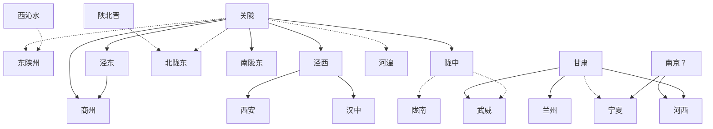
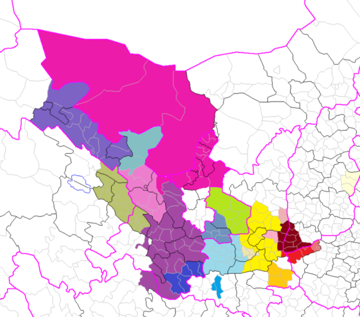

# 汉字音典西北分区（除晋语）
## 前情提要：
### 平翘类型 -

- 泗阳-宁夏型平翘：在南京型平翘的基础上，止摄一律读翘舌。分布于海泗、宁夏、川北。
- 兰州-天祝型平翘：在南京型(或许是昌黎-徐州型，存疑)平翘的基础上，仅保留了少部分止流深臻摄的区分。
- 昌黎-徐州型平翘（昌徐一型）：
- 临县-孝义型平翘（昌徐二型）：梗白读三等
- 汾阳型平翘（昌徐2.5型）：
- 韩城-临猗型平翘：知止读平舌，知蟹读翘舌。临猗型平翘本质上根本不是一种昌徐型平翘，其与昌徐型是互斥的（强调），所以这玩意不叫昌徐3型

## 关陇：
平翘类型为临猗型平翘及其后裔；常船平白读多读擦音。梗阳ie/e的同时，没有宕江的脱鼻白读。
   ### 东陕州
晓二不读洪音
   ### 西陕州
保留了大量不同泾东的特征：Tu>Tu；麻三ia；咍白ei
   ### 泾东
见二(晓母除外)一律读细音；Tu>Tou，各=割
   ### 商州
整体音系类似于泾东，但全浊入送上去不送
   ### 泾西
见二(晓母除外)一律读细音；Tu>Tou，Lu>Lou，不分NL，大多有各≠割
   ### 西安
见二(晓母除外)一律读细音；Tu>Tou，Lu>Lu，分NL
   ### 北陇东：
见二蟹读洪音；另外北部地区亦有其他晋语成分(影三不读ȵi，只有疑三读ȵi)，耕jie，大多各≠割
   ### 南陇东：
见二蟹读洪音，影三读ȵi，耕gê，各=割
   ### 陇南：
平翘类型与孝义型平翘过渡。摘tʂɤ≠侧tsɤ；全浊平入送气上去不送。
   ### 陇中：
见二江效蟹，可能还有假摄读洪音；

## 河湟：
河湟方言不是关陇；河湟平翘类型为昌徐型；常船平白读多为塞擦（尽管依然比华北更多擦）；不同于很邻近的陇中一带方言，河湟N/L-不合并
疑二（言眼...）更少读ȵi

## 甘肃：
N/L合并的西部边界、第三人称用“兀”的西部边界、入声归阴平的西部边界、临猗型平翘的西部边界高度重合，划出了甘肃方言的界线。甘肃方言较少有“棚耕硬”读e/ie的白读，此项特征能够与其他关陇分开
### 兰州
兰州型平翘可以很容易把它与周边方言区分开来。
### 宁夏
泗夏型平翘、晓二读细可以很容易把它与周边方言区分开来。
### 河西
济南型平翘可以很容易把它与周边方言区分开来。部分还有去kʰɯ
### 武威
临猗型平翘意味着这玩意与关陇是同源的。

## 不分类
不分类方言，混得太严重了的。如北疆大部分方言。

# 华北分区方案 202611
华北
├── 河北
│   ├── 本冀
│   │   ├── 燕京
│   │   ├── 保定
│   │   ├── 定州
│   │   ├── 雄安
│   │   └── 河间
│   ├── 冀东
│   │   ├── 蓟州
│   │   ├── 滦州
│   │   ├── 永平
│   │   └── 天津
│   ├── 东北
│   │   └── 热河
│   ├── 冀西
│   └── 冀南
│       ├── 真定
│       ├── 冀州
│       └── 沧州
├── 胶东
│   ├── 青潍
│   ├── 胶莱
│   ├── 东莱
│   ├── 牟海
│   │   ├── 登州
│   │   ├── 烟威
│   │   ├── 文荣
│   │   ├── 西盖桓
│   │   └── 东盖桓
│   └── 靖海卫
├── 鲁中
│   ├── 济北
│   └── 济南
├── 鲁北
│   ├── 滨州
│   ├── 武定
│   ├── 德州
│   └── Macro-东昌
├── 邯彰
├── 怀卫
│   ├── 怀庆
│   ├── 卫辉
│   ├── 孟州
│   └── 新乡
├── 上党
│   ├── 泽州
│   ├── 潞州
│   └── 东沁水
├── 河南
│   ├── 豫西
│   ├── 豫东
│   └── 大名
└── 淮海
周边跨区标注：
西北-雁北
华北-鲁北-德州
华北-鲁北-东昌
华北-河南-大名
华北-漳卫
现行汉字音典山东地区之分区方案之说明：
## 胶东：
#O←可河≠喝渴→#A
　　青潍：不分阴阳去、次浊平归阳平、次浊入归去
　　胶莱：阳去归阳平、次浊平归阳平(莱州归阴平较多)、次浊入归阴去
　　东莱：阳去归阳平、次浊平归阴平、次浊入归阴去
　　牟海：次浊入=阴入
　　　　登州：见二四白读远少于周边；全浊入→阳平；次浊平→阳平。
　　　　烟威：全浊入→阳去
　　　　文荣：见二四白读极多；全浊平不送气
　　　　西盖桓：瓦房店化的登州
　　　　东盖桓：瓦房店化的烟威
　　靖海卫：次浊入→去 全浊入→上 没有任何白读层次。是方言岛。
## 鲁中
：没什么特征
　　济北：薄o 学iau
　　济南：薄o 学ye
## 鲁北
：有大量的山东特征（见前述）
山东 ngi>i 河北 ngi>ni
山东 过ge 河北 过guo
山东 割ga 河北 割ge
山东 角jia 河北 角jiao
山东 缚fo 河北 缚pao
山东 叔u≠熟ou 河北 叔=熟ou
山东 捆uen 河北 捆yen
山东 给(~你)i 河北 给(~你)ei
　　滨州：可河e≠渴喝uo 百白ei 隔客ei 熟叔u 济南型平翘 钁au
　　武定：可河e=渴喝e=果e 百白ai 隔客ei 熟叔u 济南型平翘 钁uau
　　德州：可河e=渴喝e≠果火uo 百白ai 隔ei客ie 熟ou叔u 昌徐型平翘 钁ye
　　Macro-东昌：隔ai客ai/ie 百白ai 的纯粹立及甬
　　　　东昌内部差异巨大，就拿宕来说，有全不复化的（东昌），有浊复化清不复化的（临清，Ann亲自调查），有全复化的（茌平）
## 邯彰：
硬杏ing的
## 怀卫：
硬杏eng的
当然，具体分界线还能通过平翘解决
　　怀庆：药iʌʔ着tʂʌʔ，昌徐型平翘
　　卫辉：药yʌʔ着tʂuʌʔ，济南型平翘
　　孟州：全浊入→阳平，没有独立入声韵，昌徐型平翘
　　新乡：克苏鲁。
## 上党：
眉i的
　　泽州：不分阴阳去；耕杏eng；数u；横彭≠红蓬；北墨ei
　　潞州：分阴阳去，耕杏ing，数ou，横彭=红蓬
　　东沁水：上个版本音典分区里面「西北-沁水」里面单独找出来了不像西北的那几个点。至于和上党的区别我不好说。
## 河南：
硬杏eng//勒=裂//圪=黑
　　豫西：黑圪ɯ 数u
　　豫东：黑圪ɛ(→ie) 数uo≠书
　　大名：黑ɛ 数u
## 淮海：
杏硬ing 耕坑eng 勒≠裂 分屋三烛 圪ə≠黑ei
## 河北：→ @抑揚山鬼Sanki 
## 部分早期特征一览表
河怀淮泽潞邯河山牟
南庆海州州安北东海
否否否否是是是是是 耕ing
否否是否是是是是是 杏ing
否否否否否是是是是 额ie
？是是否否是是是否 次浊入=清入
否否是？是否是是是 屋三≠烛
否否否否是否是是否 分阴阳去
否否否否否否是否否 疑影三读ni
否是否是否否是是是 分宕江
是？？是是是否是是 见二四≠见三

