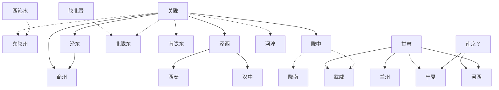

# 汉字音典西北分区（除晋语）
## 前情提要：
### 平翘类型 -
- 泗阳-宁夏型平翘：在南京型平翘的基础上，止摄一律读翘舌。分布于海泗、宁夏、川北。
- 兰州-天祝型平翘：在南京型(或许是昌黎-徐州型，存疑)平翘的基础上，仅保留了少部分止流深臻摄的区分。
- 昌黎-徐州型平翘（昌徐一型）：
- 临县-孝义型平翘（昌徐二型）：梗白读三等
- 汾阳型平翘（昌徐2.5型）：
- 韩城-临猗型平翘：知止读平舌，知蟹读翘舌。临猗型平翘本质上根本不是一种昌徐型平翘，其与昌徐型是互斥的（强调），所以这玩意不叫昌徐3型

## 关陇：
平翘类型为临猗型平翘及其后裔；常船平白读多读擦音。梗阳ie/e的同时，没有宕江的脱鼻白读。
   ### 东陕州
晓二不读洪音
   ### 西陕州
保留了大量不同泾东的特征：Tu>Tu；麻三ia；咍白ei
   ### 泾东
见二(晓母除外)一律读细音；Tu>Tou，各=割
   ### 商州
整体音系类似于泾东，但全浊入送上去不送
   ### 泾西
见二(晓母除外)一律读细音；Tu>Tou，Lu>Lou，不分NL，大多有各≠割
   ### 西安
见二(晓母除外)一律读细音；Tu>Tou，Lu>Lu，分NL
   ### 北陇东：
见二蟹读洪音；另外北部地区亦有其他晋语成分(影三不读ȵi，只有疑三读ȵi)，耕jie，大多各≠割
   ### 南陇东：
见二蟹读洪音，影三读ȵi，耕gê，各=割
   ### 陇南：
平翘类型与孝义型平翘过渡。摘tʂɤ≠侧tsɤ；全浊平入送气上去不送。
   ### 陇中：
见二江效蟹，可能还有假摄读洪音；

## 河湟：
河湟方言不是关陇；河湟平翘类型为昌徐型；常船平白读多为塞擦（尽管依然比华北更多擦）；不同于很邻近的陇中一带方言，河湟N/L-不合并
疑二（言眼...）更少读ȵi

## 甘肃：
N/L合并的西部边界、第三人称用“兀”的西部边界、入声归阴平的西部边界、临猗型平翘的西部边界高度重合，划出了甘肃方言的界线。甘肃方言较少有“棚耕硬”读e/ie的白读，此项特征能够与其他关陇分开
### 兰州
兰州型平翘可以很容易把它与周边方言区分开来。
### 宁夏
泗夏型平翘、晓二读细可以很容易把它与周边方言区分开来。
### 河西
济南型平翘可以很容易把它与周边方言区分开来。部分还有去kʰɯ
### 武威
临猗型平翘意味着这玩意与关陇是同源的。

## 不分类
不分类方言，混得太严重了的。如北疆大部分方言。

